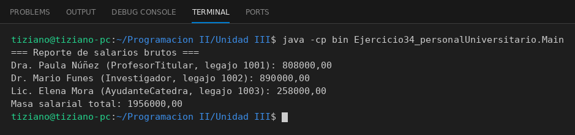

# PersonalUniversitario

Programación II - Unidad 3 - Ejercicio 34

## Consigna
Modelar una jerarquía de clases con herencia: una clase base y subclases que reutilizan código con `super` y sobrescriben métodos. Personal docente e investigador.

## Lógica
- Base con salario según antigüedad.
- `ProfesorTitular`, `Investigador` y `AyudanteCatedra` reescriben `calcularSalarioBruto()` sumando bonos propios.
- `Main` imprime un reporte con la masa salarial total.

## Ejecución

